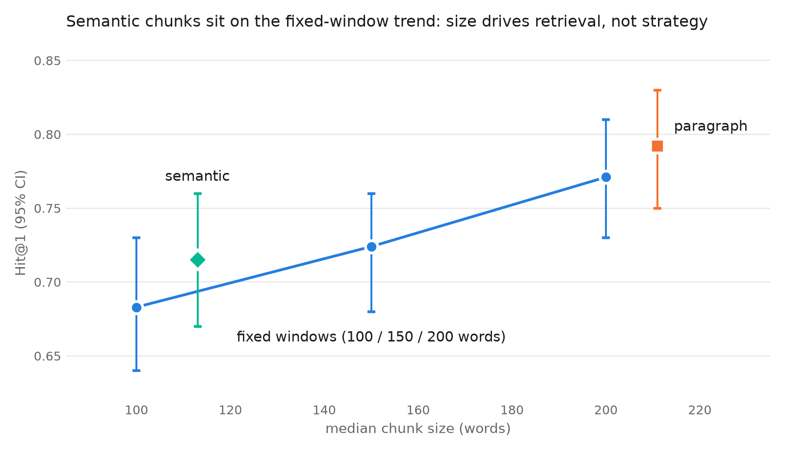

# arabic-rag-bench

A small, reproducible benchmark comparing **chunking strategies for Arabic RAG** on Arabic Wikipedia, using `BAAI/bge-m3` embeddings and LLM-generated questions whose evidence is a verbatim quote (so every chunker is judged against the same ground truth).

[](https://github.com/alialrikabi313/arabic-rag-bench/actions/workflows/test.yml)

> **TL;DR** — On 442 questions over Arabic Wikipedia, **chunk size drives retrieval quality, not chunking strategy**. Semantic chunking gave no gain over fixed windows of the same size; paragraph chunks were best *and* cheapest (Hit@1 0.792, MRR 0.863).

<p align="center">
  <picture>
    <source media="(prefers-color-scheme: dark)" srcset="docs/size-vs-hit1-dark.png">
    
  </picture>
</p>

## Why

Chunking choices in Arabic RAG are usually made by habit. This repo measures them: fixed windows vs. paragraphs vs. embedding-based semantic splits, on the same corpus and the same questions.

## Pipeline

| Step | Script | Output |
|---|---|---|
| 1 | `01_fetch_sample.py` | random Arabic Wikipedia articles (resumable, rate-limit aware) |
| 2 | `02_build_index.py` | semantic chunks + embeddings in SQLite/NumPy; list-like articles filtered out |
| 3 | `03_make_questions.py` | local LLM (Ollama) writes questions + a verbatim evidence quote; questions with non-verbatim quotes are discarded |
| 4 | `04_eval.py` | Hit@k / MRR per chunker → `results.md` |

A chunk is a correct hit if it comes from the right article and contains the middle word-window of the evidence quote (the middle, not the edges, so fixed windows that split a quote at its boundary are not unfairly penalised).

## Results

227 articles (from a frozen random sample of 300; list-like articles dropped), 442 questions, retrieval over all chunks of each method, `bge-m3` embeddings. Fixed windows use 20% overlap.

| Method | Chunks | Median words | Hit@1 | Hit@3 | Hit@5 | Hit@1 95% CI | MRR | MRR 95% CI |
|---|---|---|---|---|---|---|---|---|
| fixed-100 | 2733 | 100 | 0.683 | 0.887 | 0.932 | 0.64–0.73 | 0.793 | 0.76–0.82 |
| fixed-150 | 1850 | 150 | 0.724 | 0.907 | 0.941 | 0.68–0.76 | 0.822 | 0.80–0.85 |
| fixed-200 | 1386 | 200 | 0.771 | 0.928 | 0.952 | 0.73–0.81 | 0.853 | 0.83–0.88 |
| **paragraph** | 1096 | 211 | **0.792** | **0.932** | **0.955** | 0.75–0.83 | **0.863** | 0.84–0.89 |
| semantic (p20) | 1659 | 113 | 0.715 | 0.910 | 0.946 | 0.67–0.76 | 0.820 | 0.79–0.85 |

**What this says**

- Along the fixed-window sweep, Hit@1 rises monotonically with size (0.683 → 0.724 → 0.771). Semantic chunks (median 113 words) land exactly where that trend predicts for their size (0.715, between fixed-100 and fixed-150): **no measurable gain from the semantic splitting itself.**
- Paragraph (0.792) and fixed-200 (0.771) overlap within their confidence intervals; paragraph is the cheapest (no overlap, no extra embedding pass).
- An earlier 80-question run suggested semantic might be competitive; with 442 questions the gap to large chunks is clear. Small samples mislead.

## Limitations

- **Retrieval only.** No answer-generation quality is measured; larger chunks may cost precision or tokens downstream.
- **Wikipedia only**, and most random Arabic articles are short, which favours big chunks. Long, heterogeneous documents may behave differently.
- **Untuned semantic splitter.** One setting (breakpoint percentile 20, 40–250 words) was tried, not searched.
- **Questions are LLM-generated** (single local model); verbatim-quote validation removes hallucinated evidence but not generator bias.
- **Single embedding model** here (see [arabic-embed-bench](https://github.com/alialrikabi313/arabic-embed-bench) for model comparison).
- The sample is random and Wikipedia text changes over time; article IDs are in `sample_pageids.txt`, so re-fetching reproduces the selection but not byte-identical text.

## Run

```bash
pip install -r requirements.txt
python 01_fetch_sample.py
python 02_build_index.py
python 03_make_questions.py   # needs a local Ollama model (see config.py)
python 04_eval.py
pytest tests
```

Raw data lives outside the repo (`../arabic-rag-bench-data`, override with `ARB_DATA_DIR`). Device is auto-detected (`ARB_DEVICE=cpu|cuda` to force).

All tunables are in `config.py`; engineering decisions and rejected alternatives are logged in `decisions.md`.

## Data & attribution

Article text comes from Arabic Wikipedia (CC BY-SA 4.0); the repository contains only two short excerpts used as test fixtures (see `tests/data/ATTRIBUTION.md`).
